# How Posthaste works

A map of the code, drawn from the code itself. Read it top to bottom once, then
use it as a reference. Every diagram is [Mermaid](https://mermaid.js.org), so
GitHub draws them and they stay in version control next to the code they
describe.

| # | Diagram | Answers |
|---|---------|---------|
| 1 | [The big picture](#1-the-big-picture) | What are the pieces and who talks to whom? |
| 2 | [Crates and the rules between them](#2-crates-and-the-rules-between-them) | What may depend on what? |
| 3 | [Startup](#3-startup) | What happens between launching the app and the first window? |
| 4 | [A note is captured](#4-a-note-is-captured) | How does one keypress become a saved note? |
| 5 | [Commands and events](#5-commands-and-events) | How do the interface and the shell talk? |
| 6 | [State inside a window](#6-state-inside-a-window) | How do settings, looks and language reach the screen? |
| 7 | [Languages](#7-languages) | How does text get from a JSON file to a button? |
| 8 | [The database](#8-the-database) | What is stored, and how does the schema change safely? |
| 9 | [Build and release](#9-build-and-release) | How does source become an installer? |
| 10 | [Adding things](#10-adding-things) | Where does a new window, command, language or look go? |
| 11 | [How it scales](#11-how-it-scales) | What grows, and where are the limits? |

Rough size, in lines: interface 17.0k Rust and 3.4k CSS; shell 5.9k; storage
14.0k; shared types 1.5k; sync transport 0.7k; per-OS code 0.4k; language
catalogue 0.3k Rust and 1.4k JSON; browser tests 4.7k.

---

## 1. The big picture

Posthaste is a **Tauri 2 desktop app**. Tauri is written in Rust and gives the
app its windows, tray, global shortcuts and installers. What is drawn inside
each window is the **interface**: Rust compiled to WebAssembly (Leptos), shown
by the system webview using HTML and CSS.

There is no central server holding user data. Everything runs on the user's
computer and lives in one SQLite database (with optional peer-to-peer device
sync directly between the user's own paired computers).

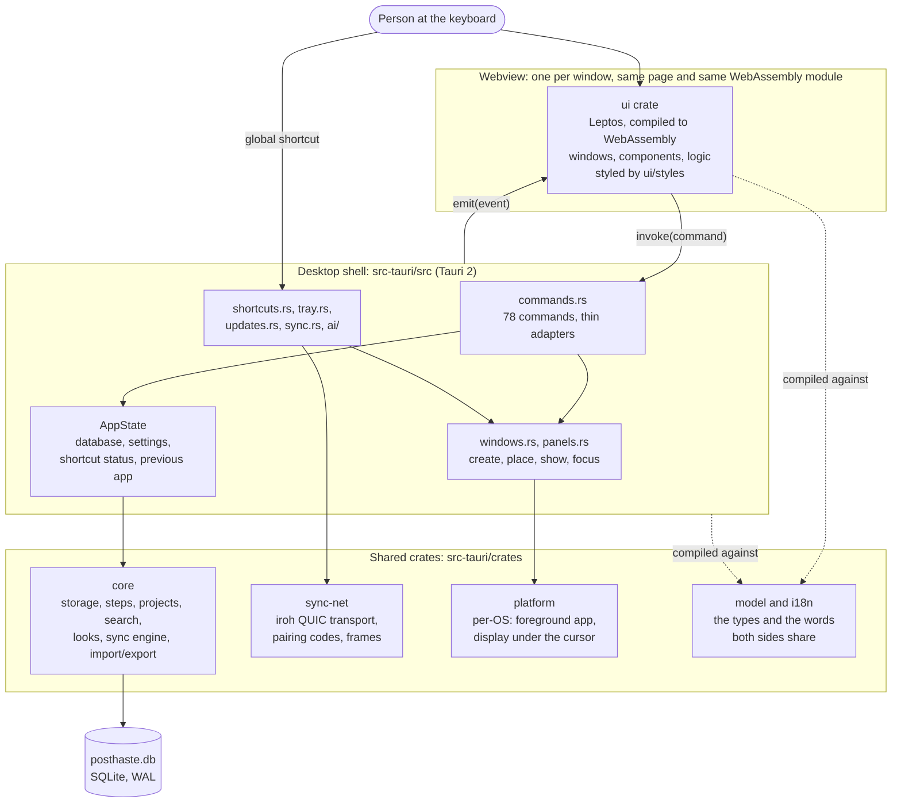

**Read it like this.** Solid arrows happen while the app runs. Dotted arrows
are compile-time: the shell and the interface both use the same `model` and
`i18n` crates, so they cannot disagree about a type or a word. Diagram 2 shows
those crates and what may depend on what.

---

## 2. Crates and the rules between them

Layers have one job each. A rule that is broken in the wrong layer is moved,
not bent (see `AGENTS.md`).

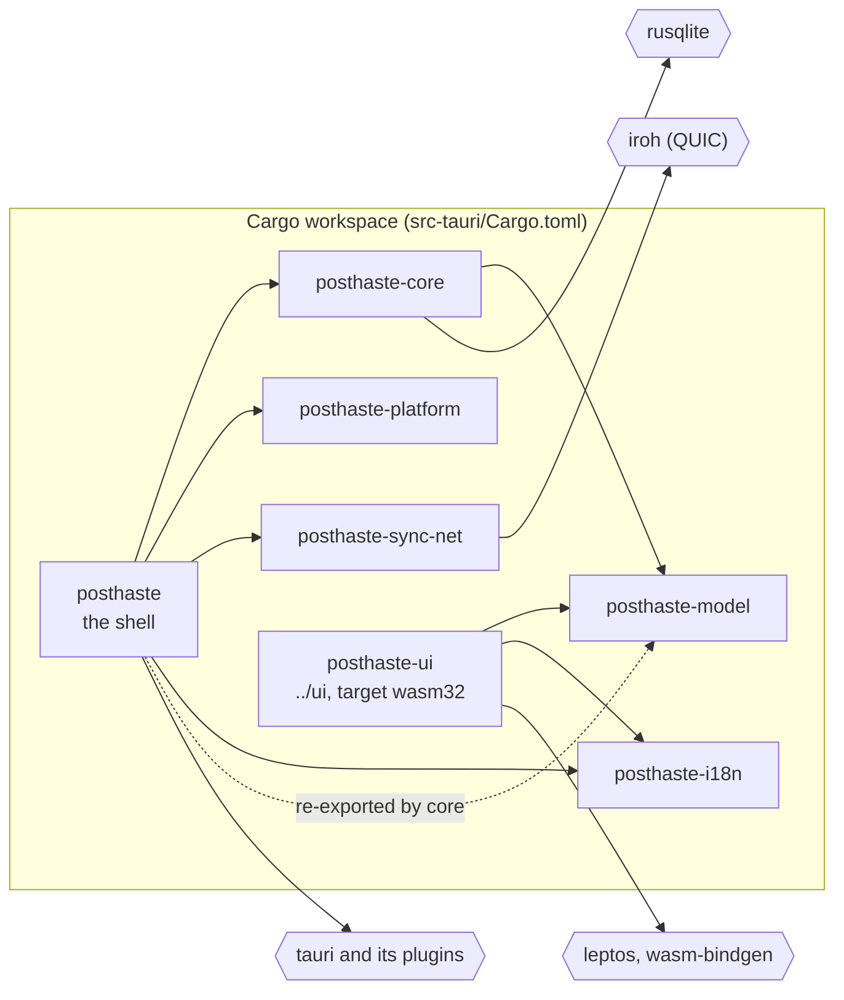

| Crate | Owns | Must not |
|---|---|---|
| `model` | Serde types on the boundary: `Note`, `Step`, `Project`, `Settings`, `ResolvedLook`, `CommandError`… | Hold logic or I/O |
| `core` | Validation, SQL, steps, projects, search, looks, sync engine, import and export | Depend on Tauri or iroh (`check-rules.sh` fails the build) |
| `i18n` | The catalogue and the `Translator` | Do I/O at run time |
| `platform` | One file per OS for "which app was focused" and "which display" | Know about notes |
| `sync-net` | iroh QUIC endpoint, single-use pairing codes, length-prefixed frame I/O | Open SQLite or use n0 lookup services |
| shell | Windows, shortcuts, tray, updates, sync service, AI polish, commands | Hold SQL or business rules |
| `ui` | Layout, keys, what is on screen | Hold business rules or name a command string outside `ipc/` |

`ui/src/logic/` is plain functions of plain values with no browser in them, so
`cargo test` runs them natively. That is where the decisions live.

---

## 3. Startup

All four windows are created **once, at startup**, hidden. Showing one later is
instant because its page and WebAssembly module are already loaded. Closing the
inbox hides it instead of quitting, so the capture shortcut keeps working.

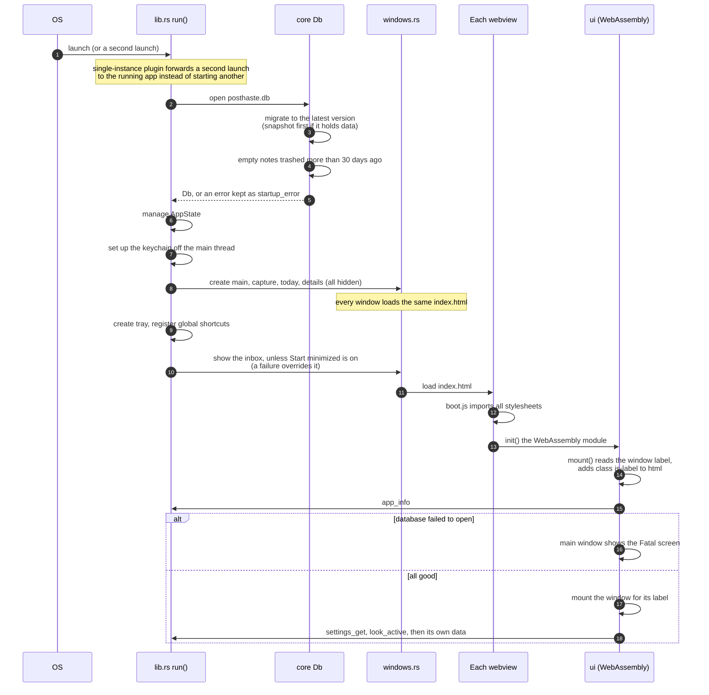

If the database cannot be opened, the app still starts and the main window
says what went wrong instead of failing silently.

---

## 4. A note is captured

The most important path in the app: a shortcut anywhere on the computer to a
saved note, then back to what the person was doing.

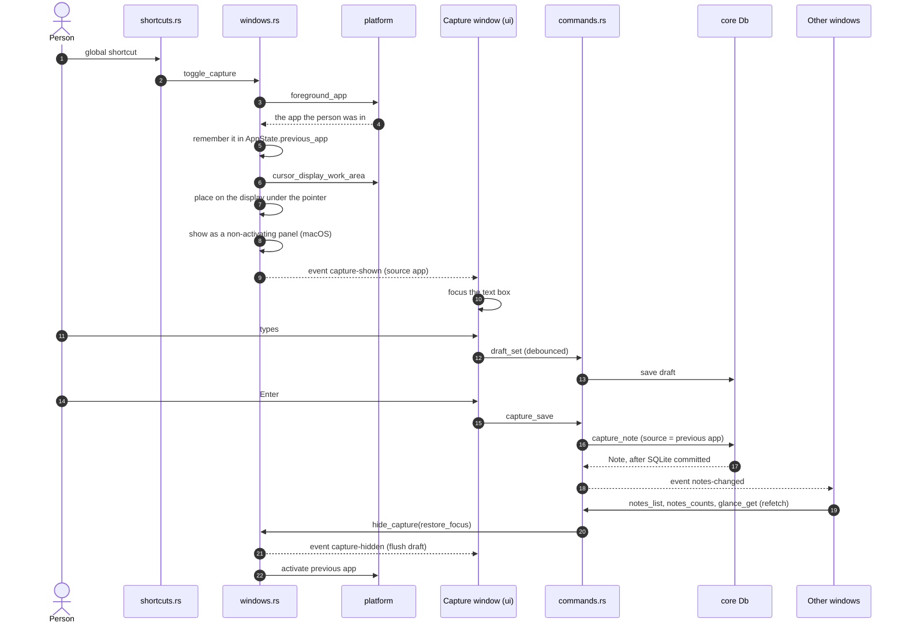

Two design choices to notice:

- **The reply waits for SQLite.** `capture_save` returns only after the commit,
  and on error the window stays open with the text still in it.
- **Windows never patch each other's lists.** They are told *something
  changed* and ask the database again. Slower than sharing memory, but no
  window can drift out of date.

---

## 5. Commands and events

The two halves of the app talk in exactly two ways.

For debugging, setting `PH_TRACE=1` makes the shell log every command a
window runs and every page load; without it, nothing per command is
logged.

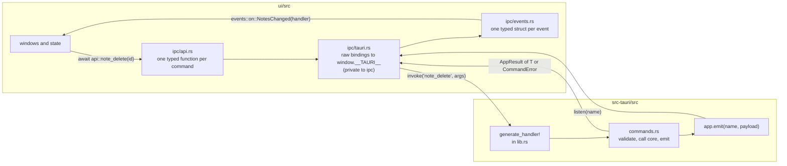

**Commands** are requests with an answer (78 of them: capture, notes, steps,
projects, trash, details and attachments, settings, data, looks, AI polish,
device sync, updates). Each is one function in `commands.rs` that checks its
input, calls `core`, and returns a result. No SQL lives there.

**Events** are announcements with no answer. The shell says something changed
and each window decides what to fetch.

| Event | Meaning | A window usually… |
|---|---|---|
| `notes-changed` | A note was added, edited, moved or deleted | refetches its list |
| `settings-changed` | Settings were saved | refetches settings |
| `looks-changed` | A look was saved, imported or deleted | refetches the active look |
| `sync-changed` | Paired device sync status or peer list changed | refetches sync status and peers |
| `capture-shown` / `capture-hidden` | The capture window appeared or went away | focuses, or flushes its draft |
| `today-shown` / `today-returned` | The Today window appeared, or got control back when note details closed | reloads, restores focus |
| `details-open` | Show this note | opens it |
| `details-close-requested` | About to hide | stores what was typed |
| `navigate`, `inbox-show-date` | Go to a section, or to a day | changes the main view |

Why this is easy to grow: **no string for a command or an event name appears
outside `ipc/`**. A typo is a compile error, and `ui/tests/harness.mjs` fakes
the whole shell so every window is testable without Tauri.

---

## 6. State inside a window

Each window builds three small handles at the top and passes them down as
props. There is no global state.

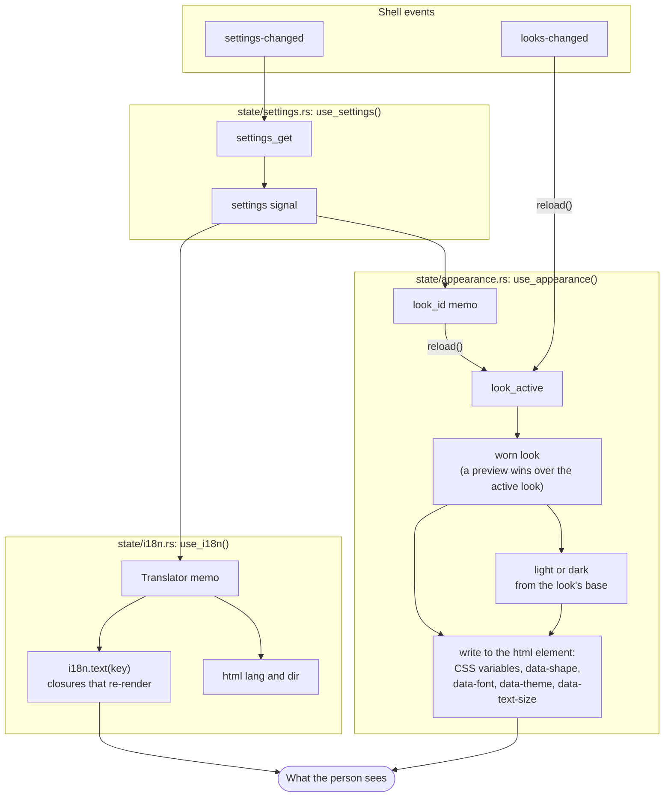

Three rules this follows:

- **One writer per thing.** Only `appearance.rs` writes colour variables and
  `data-theme`. Only `i18n.rs` writes `lang` and `dir`.
- **Messages are stored as keys, not text.** A toast already on screen follows
  a language change because `Message` keeps `(key, values)` and turns it into
  words when it is drawn.
- **Read, don't `track()`.** To make an effect depend on a value, read it with
  `value.with(|_| ())`. A memo that is only tracked is never computed, so the
  effect never runs again. This was the bug behind the look not changing, and
  `check-rules.sh` now rejects `.track()`.

---

## 7. Languages

English is the source of truth. Everything else is checked against it **when
the app is built**.

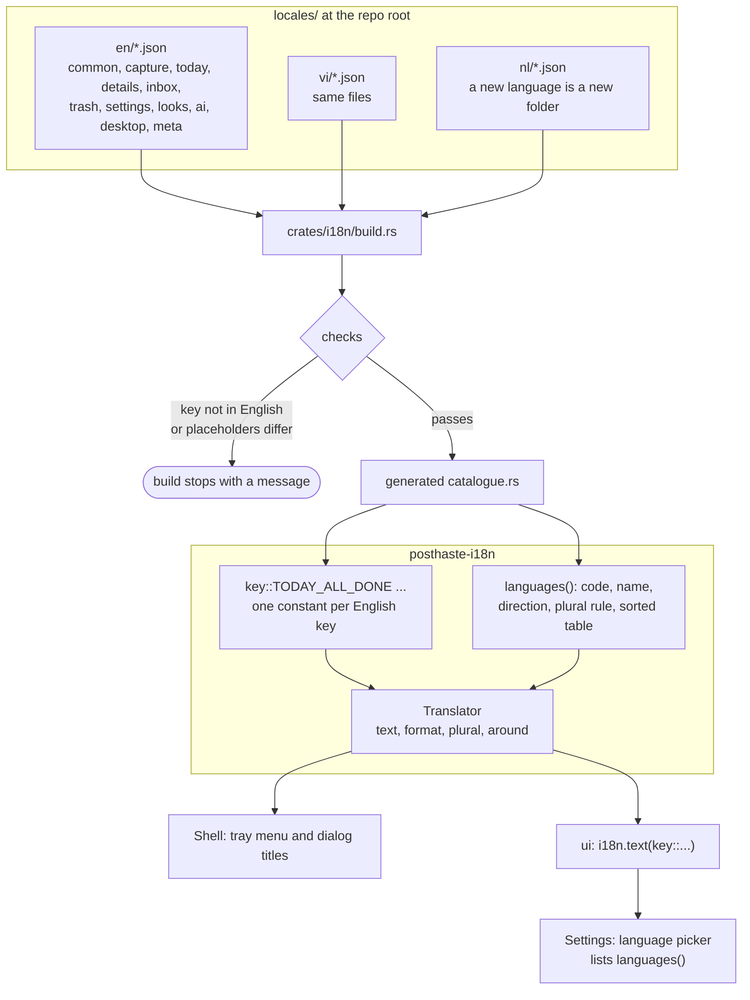

What a lookup does: find the key in the chosen language by binary search; if
that language has not translated it yet, use the English text; if the saved
language code is unknown, use English. Plural messages choose a form by the
language's rule (`one_other` for English and Dutch, a single form for
Vietnamese).

The build stops if a language has a key English lacks or uses different
`{placeholders}`. A key a language has not translated yet is allowed, so a
half-finished translation can still ship, and the `every_language_is_complete`
test lists what is missing.

---

## 8. The database

One SQLite file in WAL mode. Timestamps are milliseconds since the Unix epoch
(UTC).

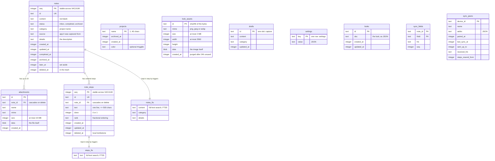

Schema changes only ever **append**. A shipped migration is never edited.

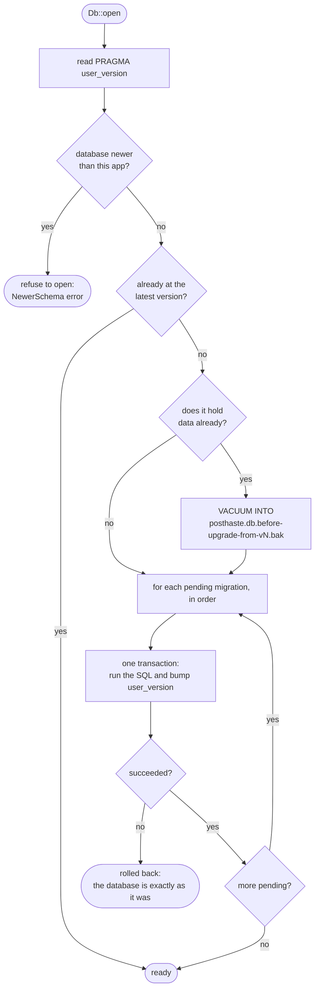

Today there are 11 migrations (`0001_init` through `0011_project_custom_color`):
initial tables, full-text search, looks, details and attachments, Later, look
image assets, device sync (`sync_fields`, `sync_peers`, `sync_state`), note
steps (`note_steps`, `steps_fts`, `sync_held_steps`), projects, and project
colours. Opening a database made by a newer version is refused instead of
guessed at, which is why you cannot simply downgrade the app after it has
upgraded your data.

---

## 9. Build and release

On a machine, the interface is built first, then the shell embeds it:

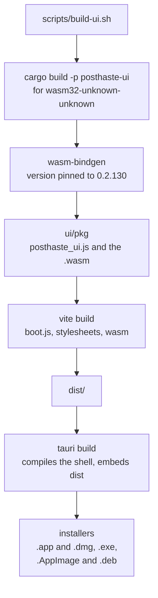

In CI the same steps run on three systems, and the app later finds updates
from the release that CI publishes:

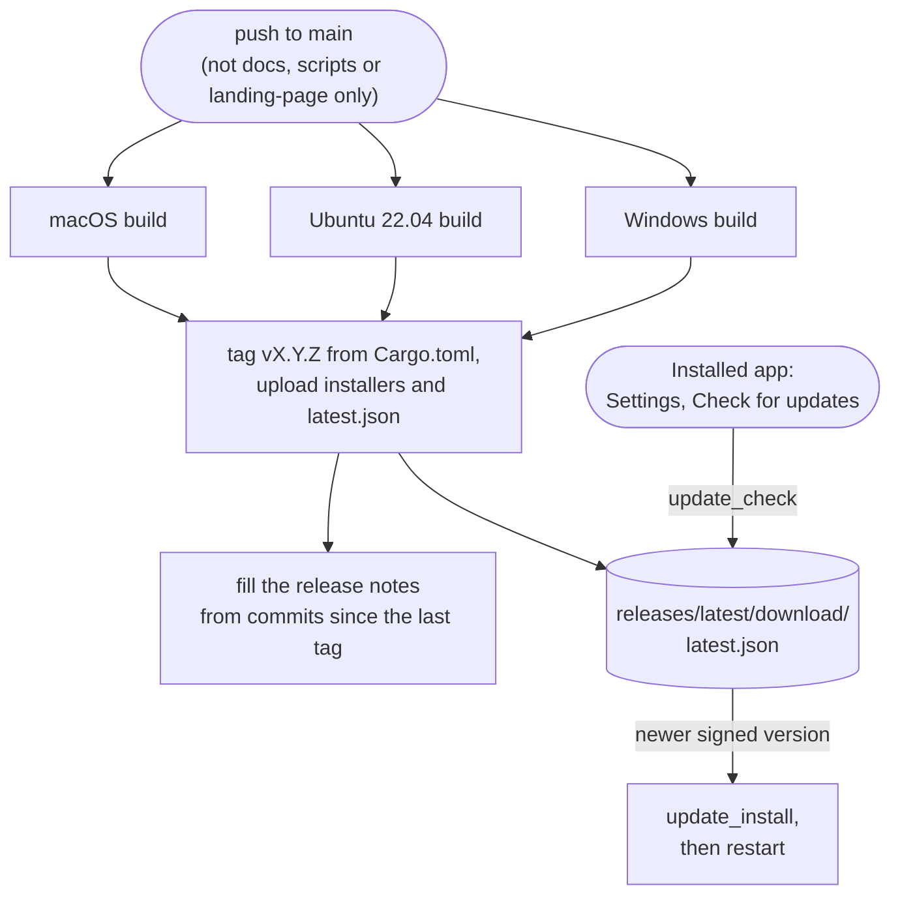

Notes:

- The app version lives in `src-tauri/Cargo.toml` (`[workspace.package]`),
  mirrored in `src-tauri/Cargo.lock` and `landing-page/src/config.ts`.
  `check-rules.sh` fails if `tauri.conf.json` or `package.json` carries a
  `"version"`, or if `Cargo.lock` or `landing-page/src/config.ts` is out of
  sync with `src-tauri/Cargo.toml`. See [docs/release-guide.md](release-guide.md)
  for the full release checklist.
- Docs, scripts and the landing page are in the workflow's `paths-ignore`, so
  a push that only touches them builds and releases nothing.
- Updates are checked from Rust (`update_check`, `update_install`) against the
  signed `latest.json` of the newest release.

---

## 10. Adding things

Each thing has one path. Follow it instead of inventing a parallel one.

```mermaid
flowchart TB
  subgraph feature["A feature, end to end"]
    f1["1. Db method in core, with tests"] --> f2["2. Types in model"]
    f2 --> f3["3. Thin command in commands.rs,<br/>registered in lib.rs"]
    f3 --> f4["4. Typed wrapper in ui/src/ipc/api.rs<br/>and a default answer in the test harness"]
    f4 --> f5["5. Text in locales/, every language"]
    f5 --> f6["6. Use it in a window,<br/>test it against the harness"]
  end

  subgraph window["A window"]
    w1["ui/src/windows/name.rs<br/>a struct of signals,<br/>actions as methods"] --> w2["one arm in windows/mod.rs<br/>for its label"]
    w2 --> w3["create it in windows.rs<br/>and list it in capabilities/default.json"]
    w3 --> w4["style under .is-name<br/>in ui/styles"]
  end

  subgraph lang["A language"]
    l1["new folder locales/xx/<br/>with the same files and meta.json"] --> l2["set name, dir and plural rule"]
    l2 --> l3["run the i18n tests:<br/>they list what is missing"]
  end

  subgraph look["A look"]
    k1["colours and shape are data:<br/>a LookDoc JSON"] --> k2["core validates and derives<br/>the CSS variable tokens"]
    k2 --> k3["the UI only applies the tokens<br/>to the html element"]
  end

  subgraph layer["A scene layer kind"]
    y1["model/look/kinds/name.rs:<br/>the config, its LIMITS and allowed regions"] --> y2["model/look/layer.rs:<br/>a Known variant and a read branch"]
    y2 --> y3["core look scene.rs check arm<br/>and resolve.rs draw arm"]
    y3 --> y4["ui/components/scene/name.rs<br/>and an arm in its dispatcher"]
    y4 --> y5["an editor section<br/>in look_editor/scene/"]
    y5 --> y6["strings in locales/"]
    y6 --> y7["tests: a valid case, each limit,<br/>a round trip through a future build"]
  end

  subgraph schema["A table or column"]
    s1["new numbered .sql file"] --> s2["add it to MIGRATIONS"]
    s2 --> s3["never edit a shipped one"]
  end
```

A language only needs Rust when it has plural forms the existing two rules
(`other`, `one_other`) do not cover.

**Adding a scene layer kind touches seven places**, in this order: the kind's
own file in `crates/model/src/look/kinds/`, a `Known` variant and a branch in
`layer.rs`, a check arm in `core/src/look/scene.rs` and a draw arm in
`core/src/look/resolve.rs`, a renderer in `ui/src/components/scene/` with its
`SceneHost` arm, an editor section in `look_editor/scene/`, strings in
`locales/`, and tests. The compiler finds the check and draw arms (matches on
`Known` may not have a wildcard arm — `check-rules.sh` enforces it); the
editor and the locales it cannot, so the checklist is here.

**Scene vocabulary is closed on purpose.** Anchors, sticker sizes and tilts
are fixed lists that each map to one CSS class; free numeric positions,
sizes or angles are refused in the format and must not be added. Every free
number is a layout bug waiting for a window size nobody tested. Add a value
to a list instead, with its class, when a look genuinely needs it.

**Look files (.phlook) refuse anything they cannot verify**: the size gate
runs before parsing, the format and version must match, every image's bytes
must hash to the id they travel under, must be listed by the look, must not
be missing, and must match what the document claims (type, size, size in
pixels). The install is one transaction: either the images and the look land
together, or nothing is written. Simple looks is applied in storage, so no
window can forget to obey it; look images live in SQLite next to
attachments, content-addressed by their hash.

---

## 11. How it scales

"Scale" here means three things: more **users' data**, more **features and
people on the code**, and more **languages and platforms**. For a local app the
first matters least and the other two matter most.

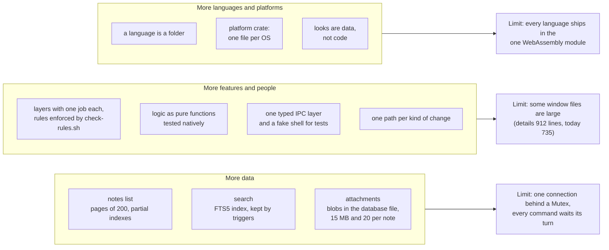

| Area | How it behaves today | Where it will strain | What to do then |
|---|---|---|---|
| **Notes list** | Loads 200 at a time. Indexes cover live notes by status and by date, and trashed notes separately. | A view that needs far more than a page | Already paged, so nothing to do until a real view needs more. |
| **Search** | SQLite FTS5, kept current by triggers. | Query design, not volume, before tens of thousands of notes | Keep queries on the index; add ranking only if people ask. |
| **Attachments** | Stored as blobs inside `posthaste.db`, up to 15 MB each and 20 per note. | The file grows with every attachment, and backups and `VACUUM` copy it all | Move large files beside the database and keep only their names in it. |
| **Database access** | One connection behind a `Mutex`. Every command waits for the one before it. | A slow operation (export, import, a big attachment) blocks the rest | Fine for one person. If it hurts, split reads from writes (WAL already allows it). |
| **Windows** | Four webviews load at startup, each with the page, all stylesheets and the whole WebAssembly module (about 1.9 MB, 500 kB compressed). | Startup time and memory grow with each window you add | Create rarely used windows on first use, or split the module per window. |
| **Events** | `notes-changed` makes every window refetch. | Cheap with four windows, noisy with many | Send a hint of *what* changed so windows can skip the refetch. |
| **Languages** | Each adds about 20 to 25 kB of text to the module, and the build checks it against English. | Dozens of languages in one file; partial translations can ship | Fail CI on missing keys; load one language at a time past about ten. |
| **Plural rules** | Two rules: `other` and `one_other`. | Languages with more forms (Russian, Polish, Arabic) | Add the rule to `PluralRule` first; the build says so. |
| **Schema** | Append-only, transactional, with a snapshot before an upgrade. | No downgrade path | Keep migrations small; never rename in place. |
| **Platforms** | One file per OS in `platform`; Mac panels are macOS-only code. | Behaviour that differs per OS cannot be tested on one machine | Keep OS code thin and tested on each OS before a release. |
| **Code size** | Window files are single structs of signals with actions as methods. | `details.rs` and `today.rs` approach a size where they should split | Move pure decisions to `logic/` and sub-views to their own files as they grow. |

**Habits that keep it scalable**

- Put a decision in `core` or `ui/src/logic` where it can be tested without a
  window.
- Cross the boundary only through `ipc/` and `model`.
- Ask the database again instead of copying its answers.
- Put every word a person reads in `locales/`.
- Run `npm run check`, `cargo clippy --workspace --all-targets -- -D warnings`
  and `cargo test --workspace` before a change is called done.
